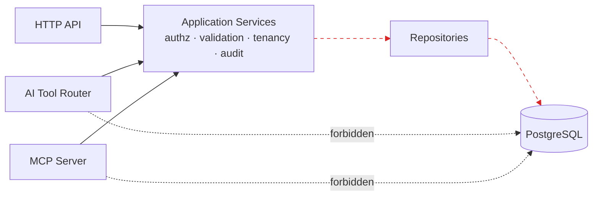

# RecruitFlow Documentation

> **The AI-native operating system for recruitment.**

RecruitFlow is a multi-tenant Recruitment CRM + Applicant Tracking System covering the full
hiring lifecycle:

```
Organization → Recruiters → Jobs → Candidates → Applications → Screening → Interviews → Offers → Hired
```

## Reading order

| #   | Document                                             | What it answers                                                          |
| --- | ---------------------------------------------------- | ------------------------------------------------------------------------ |
| 1   | [product-requirements.md](./product-requirements.md) | What are we building, for whom, and what counts as done?                 |
| 2   | [system-design.md](./system-design.md)               | What are the runtime components and how do requests flow through them?   |
| 3   | [architecture.md](./architecture.md)                 | How is the code organised? What are the module boundaries and layers?    |
| 4   | [database.md](./database.md)                         | The data model, ER diagram, indexes, constraints, tenancy columns.       |
| 5   | [api.md](./api.md)                                   | HTTP surface, conventions, pagination, filtering, errors, authorization. |
| 6   | [data-flows.md](./data-flows.md)                     | Step-by-step traces of the 16 core flows.                                |
| 7   | [ai-architecture.md](./ai-architecture.md)           | AI orchestrator, tool system, provider abstraction, AI safety.           |
| 8   | [rag-architecture.md](./rag-architecture.md)         | _(Extension point)_ RAG interfaces and tenant-aware retrieval contract.  |
| 9   | [mcp-architecture.md](./mcp-architecture.md)         | _(Extension point)_ MCP server/tool/resource contracts.                  |
| 10  | [security.md](./security.md)                         | Tenant isolation, RBAC, input validation, AI-specific threats.           |
| 11  | [scalability.md](./scalability.md)                   | 1k → 100k → 1M+ candidates: what changes at each step.                   |
| 12  | [engineering-rules.md](./engineering-rules.md)       | Non-negotiable rules for anyone (human or agent) writing code here.      |
| 13  | [development-roadmap.md](./development-roadmap.md)   | Phases, deliverables, and current status.                                |
| —   | [adr/](./adr/)                                       | Architecture Decision Records.                                           |

## The three architectural commitments

Everything else is negotiable. These are not.

### 1. AI and MCP never touch the database

Every AI tool call and every MCP tool call enters through the **same application services**
that the HTTP API uses, and therefore inherits the same validation, the same authorization,
the same tenant scoping, and the same audit logging.



### 2. Tenant isolation is structural, not incidental

Every tenant-scoped row carries `organization_id`. Every repository call requires a
`TenantContext`. Postgres Row-Level Security is enabled as a second, independent layer.
A missing tenant filter is a bug that should fail a test, not a code review.

### 3. AI is an enhancement, never a dependency

If the LLM provider is down, the API key is missing, RAG is unavailable, or MCP is
disabled — **RecruitFlow still works as a complete recruitment CRM**. AI features degrade
to disabled UI affordances. No core write path calls an LLM synchronously.

## Reserved modules (implemented separately by the project owner)

These have interfaces and extension points defined here, but deliberately **no**
implementation in the base build:

- **Authentication** — OAuth, sessions/JWT, MFA, SSO
- **RAG** — embeddings, chunking, vector store, retrieval, reranking
- **MCP** — server, tools, resources, external integrations
- **Advanced agents** — autonomous multi-step agent framework

See [development-roadmap.md](./development-roadmap.md) for what is in scope for the base build.
