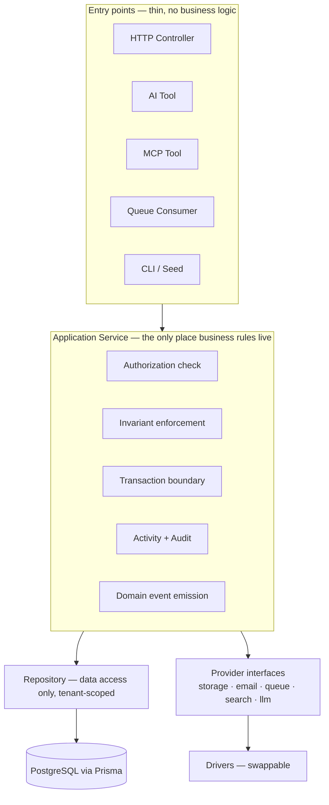
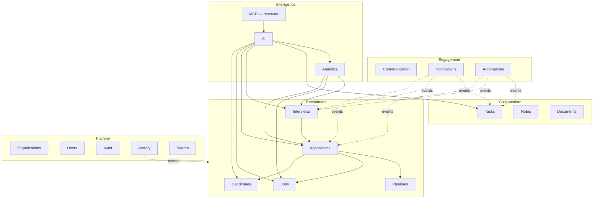
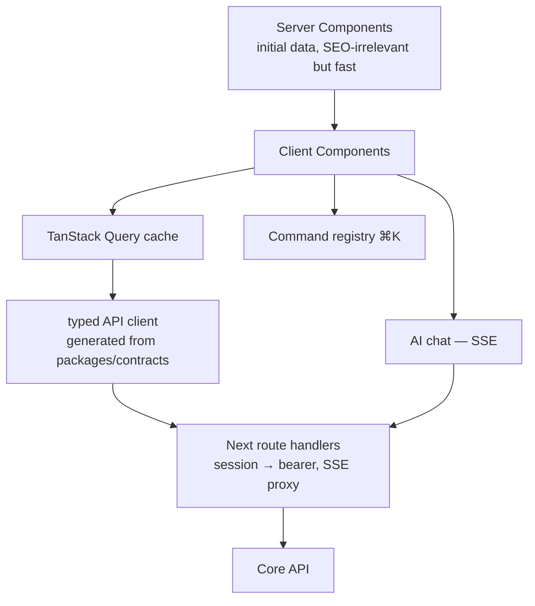

# RecruitFlow — Code Architecture

Runtime topology lives in [system-design.md](./system-design.md). This document covers how the
**source tree** is organised, what the layers are, and where the boundaries are.

## 1. Stack

| Concern     | Choice                                              | Why                                                                                                |
| ----------- | --------------------------------------------------- | -------------------------------------------------------------------------------------------------- |
| Repo        | npm workspaces + Turborepo                          | Shared contracts between web/api/worker with no publishing step; task caching.                     |
| Frontend    | Next.js 15 (App Router), React 19, TypeScript       | Server components for list-heavy CRM screens; streaming for AI chat.                               |
| UI          | Tailwind CSS + Radix primitives (shadcn/ui pattern) | Owned, accessible components — not a generic admin template.                                       |
| Client data | TanStack Query + TanStack Table                     | Cache invalidation and server-driven tables at 100k+ rows.                                         |
| Forms       | react-hook-form + Zod resolver                      | Same Zod schema validates the form and the API body.                                               |
| Backend     | NestJS 11 (Fastify adapter)                         | DI, module boundaries, guards/interceptors/pipes map exactly onto the layering this product needs. |
| ORM         | Prisma                                              | Typed queries, first-class migrations, client extensions for tenant scoping.                       |
| Database    | PostgreSQL 16                                       | Relational integrity, JSONB, FTS, partitioning, RLS, and pgvector if RAG wants it.                 |
| Queue/cache | Redis + BullMQ                                      | Behind `QueueProvider`/`CacheProvider`.                                                            |
| Tests       | Vitest, Supertest + Testcontainers, Playwright      | Unit / integration / E2E.                                                                          |

> **Assumption stated explicitly:** the repository was empty, so this stack was chosen rather
> than inherited. Nothing above is load-bearing for the _architecture_ — the layering, module
> boundaries, and abstractions survive a stack swap. See
> [adr/0002-stack-selection.md](./adr/0002-stack-selection.md).

## 2. Layering



**Rule:** every arrow into `Application Service` carries a `TenantContext`. There is no
overload without one.

### What belongs in each layer

| Layer      | Does                                                                                        | Never does                                               |
| ---------- | ------------------------------------------------------------------------------------------- | -------------------------------------------------------- |
| Controller | Parse/validate input, call one service method, map to HTTP                                  | Query the DB, branch on business rules, compose services |
| Service    | Authorize, enforce invariants, orchestrate repos + providers, own transactions, emit events | Know about HTTP, know about the LLM, build SQL           |
| Repository | Typed data access, tenant-scoped, pagination, index-aware queries                           | Authorize, emit events, call other repositories' domains |
| Provider   | Talk to one external system behind an interface                                             | Contain recruitment business rules                       |

## 3. Project structure

```text
recruitflow/
├── apps/
│   ├── web/                        # Next.js 15 — UI + thin BFF
│   │   ├── app/
│   │   │   ├── (auth)/             # auth entry points (reserved)
│   │   │   ├── (app)/              # authenticated shell
│   │   │   │   ├── dashboard/
│   │   │   │   ├── candidates/
│   │   │   │   ├── jobs/
│   │   │   │   ├── applications/
│   │   │   │   ├── pipeline/
│   │   │   │   ├── interviews/
│   │   │   │   ├── tasks/
│   │   │   │   ├── messages/
│   │   │   │   ├── analytics/
│   │   │   │   ├── assistant/
│   │   │   │   ├── automations/
│   │   │   │   └── settings/
│   │   │   └── api/                # BFF only: session cookie → API bearer, SSE proxy
│   │   ├── components/
│   │   │   ├── ui/                 # primitives: button, input, dialog, table…
│   │   │   ├── data/               # DataTable, Kanban, Timeline, ActivityFeed, Filters
│   │   │   ├── charts/             # funnel, trend, distribution
│   │   │   ├── command/            # ⌘K command palette + registry
│   │   │   └── ai/                 # chat, message, tool-call card, confirmation dialog
│   │   ├── features/               # per-module client logic (queries, mutations, forms)
│   │   ├── lib/                    # api client, formatters, hooks, permissions helper
│   │   └── styles/
│   │
│   ├── api/                        # NestJS — modular monolith
│   │   └── src/
│   │       ├── main.ts
│   │       ├── app.module.ts
│   │       ├── config/             # Zod-validated env, typed config service
│   │       ├── common/             # guards, pipes, filters, interceptors, decorators
│   │       │   ├── tenancy/        # TenantContext, tenant guard, prisma extension
│   │       │   ├── authz/          # permissions, @RequirePermissions, policy service
│   │       │   ├── errors/         # AppError taxonomy + exception filter
│   │       │   ├── pagination/     # cursor + offset helpers
│   │       │   └── observability/  # logger, request-id, metrics, tracing
│   │       ├── modules/            # ← the module boundaries; see §4
│   │       │   ├── organizations/
│   │       │   ├── users/
│   │       │   ├── candidates/
│   │       │   ├── jobs/
│   │       │   ├── applications/
│   │       │   ├── pipelines/
│   │       │   ├── interviews/
│   │       │   ├── tasks/
│   │       │   ├── notes/
│   │       │   ├── documents/
│   │       │   ├── communication/
│   │       │   ├── notifications/
│   │       │   ├── activity/
│   │       │   ├── audit/
│   │       │   ├── search/
│   │       │   ├── analytics/
│   │       │   ├── automations/
│   │       │   └── ai/             # HTTP boundary for AI; delegates to packages/ai
│   │       ├── mcp/                # reserved — see packages/mcp
│   │       ├── events/             # outbox, dispatcher, event contracts
│   │       └── providers/          # driver implementations bound to interfaces
│   │           ├── storage/        # local, s3
│   │           ├── email/          # console, smtp
│   │           ├── queue/          # bullmq, inmemory
│   │           ├── cache/          # redis, inmemory
│   │           ├── search/         # postgres
│   │           └── auth/           # dev driver (real auth reserved)
│   │
│   └── worker/                     # BullMQ consumers; imports api's service layer
│       └── src/processors/
│
├── packages/
│   ├── database/                   # Prisma schema, migrations, seed, generated client
│   ├── contracts/                  # Zod schemas + inferred types shared by web/api/ai/mcp
│   ├── core/                       # framework-free domain types, enums, errors, permissions
│   ├── ai/                         # provider-agnostic AI layer
│   │   ├── providers/              # LLMProvider interface + drivers
│   │   ├── orchestrator/           # conversation loop, streaming, context builder
│   │   ├── tools/                  # AgentTool registry + tool definitions
│   │   ├── agents/                 # Agent abstraction (reserved implementations)
│   │   ├── rag/                    # RAG interfaces only (reserved)
│   │   ├── prompts/                # versioned system prompts
│   │   └── memory/                 # conversation memory interface
│   ├── mcp/                        # reserved — server, tools, resources, schemas
│   ├── config/                     # shared tsconfig/eslint/prettier presets
│   └── testing/                    # fixtures, factories, tenant-isolation test kit
│
├── docs/                           # this documentation
├── infrastructure/                 # Dockerfiles, compose, CI, deploy manifests
└── docker-compose.yml
```

### Where reserved modules plug in

| Reserved       | Extension point                                                                                      |
| -------------- | ---------------------------------------------------------------------------------------------------- |
| Authentication | `apps/api/src/providers/auth/` implements `AuthProvider` from `packages/core`. Nothing else changes. |
| RAG            | `packages/ai/rag/` interfaces; a driver package implements them and is bound in config.              |
| MCP            | `packages/mcp/{server,tools,resources,schemas}` reusing `packages/ai/tools` definitions.             |
| Agents         | `packages/ai/agents/` implements the `Agent` abstraction over the existing tool registry.            |

## 4. Module boundaries

Each `modules/<name>` folder is a self-contained unit:

```text
modules/candidates/
├── candidates.module.ts        # DI wiring
├── candidates.controller.ts    # HTTP only
├── candidates.service.ts       # business logic + authorization
├── candidates.repository.ts    # Prisma access, tenant-scoped
├── candidates.mapper.ts        # entity → DTO
├── dto/                        # request/response types (from packages/contracts)
├── events.ts                   # events this module emits
└── __tests__/
```

**Cross-module rules**

1. A module may import another module's **service**, never its **repository**.
2. Preferred coupling is an **event**, not a call. Notifications listens for
   `application.stage_changed`; Applications has never heard of Notifications.
3. Shared types live in `packages/contracts` or `packages/core`, never in a sibling module.
4. Circular module dependencies are a build error.

These rules are what make a later extraction of, say, Analytics or AI into its own service a
mechanical change rather than a rewrite. See
[adr/0001-modular-monolith.md](./adr/0001-modular-monolith.md).



## 5. Tenant context

```ts
// packages/core/src/tenancy.ts  (shape, for orientation)
interface TenantContext {
  organizationId: string; // absent only for SUPER_ADMIN platform operations
  userId: string;
  roles: Role[];
  permissions: ReadonlySet<Permission>;
  requestId: string;
  actor: { type: 'USER' | 'AI' | 'MCP' | 'SYSTEM'; onBehalfOfUserId?: string };
}
```

`actor` is the mechanism that makes AI and MCP actions auditable _without_ giving them their
own privileges: an AI actor always carries the invoking user's permission set. The AI can
never do something the user could not do themselves.

Enforcement is layered:

1. **Guard** builds `TenantContext` from the authenticated principal.
2. **Repository signature** requires it — `findMany(ctx, filter)`, never `findMany(filter)`.
3. **Prisma client extension** injects `organization_id` into every query on a tenant table
   and throws if the model is tenant-scoped but the context is missing.
4. **Postgres RLS** rejects the query even if layers 1–3 are all bypassed.

Details and threat model in [security.md](./security.md).

## 6. Frontend architecture



- **Server components** render list and detail shells with first-page data; interactive
  tables, Kanban, and forms are client components.
- **The BFF is thin by rule.** It attaches credentials and proxies streams. Business logic in
  `app/api/` is a review-blocking defect — it would be logic that AI and MCP callers, which
  never pass through Next.js, cannot see.
- **Permissions in the UI are cosmetic.** `can('candidate.delete')` hides a button; the
  service still checks. Both, always.
- **Theming** uses CSS custom properties with `light`/`dark` token sets; no component
  hard-codes a colour.

## 7. Error taxonomy

One error type crosses all entry points, so HTTP, AI tools, and MCP tools report failures
identically.

| `AppError` code        | HTTP | Meaning                                                                   |
| ---------------------- | ---- | ------------------------------------------------------------------------- |
| `VALIDATION_FAILED`    | 400  | Input failed schema or business validation                                |
| `UNAUTHENTICATED`      | 401  | No valid principal                                                        |
| `FORBIDDEN`            | 403  | Principal lacks the required permission                                   |
| `NOT_FOUND`            | 404  | Absent, **or** present in another tenant (deliberately indistinguishable) |
| `CONFLICT`             | 409  | Uniqueness or state-machine violation                                     |
| `UNPROCESSABLE`        | 422  | Valid input, invalid domain transition                                    |
| `RATE_LIMITED`         | 429  | Quota exceeded (incl. AI budget)                                          |
| `PROVIDER_UNAVAILABLE` | 503  | External dependency down — LLM, SMTP, storage                             |
| `INTERNAL`             | 500  | Unexpected; logged with trace id, never leaked to client                  |

Returning `NOT_FOUND` rather than `FORBIDDEN` for cross-tenant reads is intentional: a 403
would confirm that the resource exists in _someone's_ tenant, which is itself a leak.
