# RecruitFlow — Data Flows

Step-by-step traces of the sixteen flows that define the product. Each shows where
authorization, transactions, events, and async work sit.

Shared conventions: every flow begins with the guard chain building a `TenantContext`; every
write commits its state change, activity, audit row, and outbox event in **one transaction**;
every side effect is consumed from the queue.

---

## 1. Candidate creation

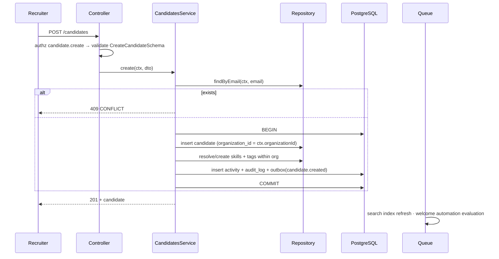

`ownerId` defaults to the caller. The `search_vector` is maintained by a database trigger, so
an import path that bypasses the service cannot leave the index stale.

---

## 2. Job creation and publication

Creation writes a `DRAFT` — deliberately permissive, because a recruiter drafting a role should
not be blocked by missing fields.

Publication is a separate endpoint (`POST /jobs/:id/publish`) precisely so it can assert
preconditions: description present, pipeline assigned, at least one recruiter, salary range
coherent. It transitions `DRAFT → OPEN`, sets `published_at`, and emits `job.published`. A
generic `PATCH {status}` could enforce none of this and would let a client drive the job into
any state.

---

## 3. Application creation

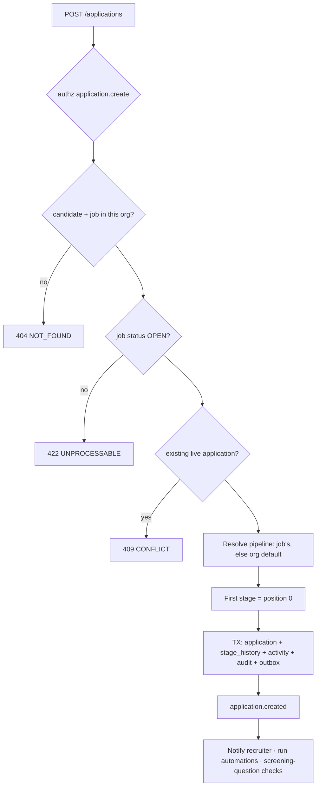

`stage_entered_at` is set at creation so SLA queries work from the first moment.

---

## 4. Resume upload

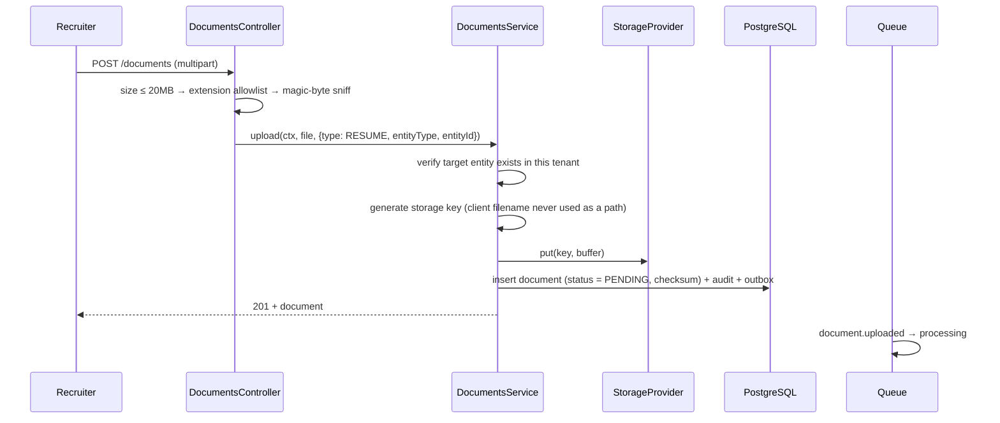

Storage write precedes the database row: an orphaned object is reconciled by a sweeper, whereas
a database row pointing at a missing object is a user-visible broken download.

---

## 5. Resume processing _(async)_

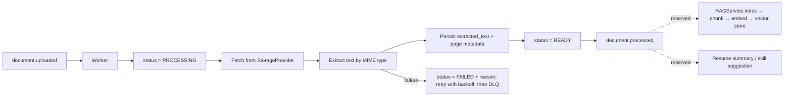

Everything downstream of extraction is an enhancement. A `FAILED` document is still
downloadable, and the candidate record is unaffected.

---

## 6. Pipeline stage change

The most-executed write in the product, and the source of every velocity metric.

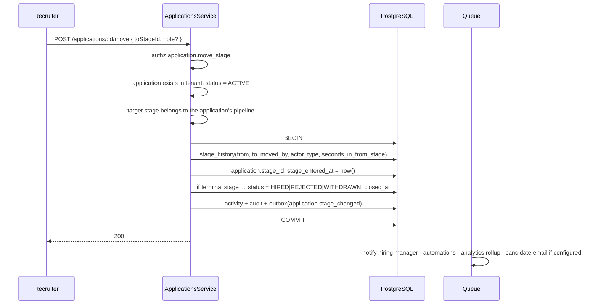

`seconds_in_from_stage` is computed here rather than derived later, because funnel analytics
over millions of history rows must not require a self-join.

Bulk moves (`POST /applications/bulk/move`, ≤100 ids) process per application and report
per-id success or failure — one invalid target must not roll back 99 valid moves.

---

## 7. Interview scheduling

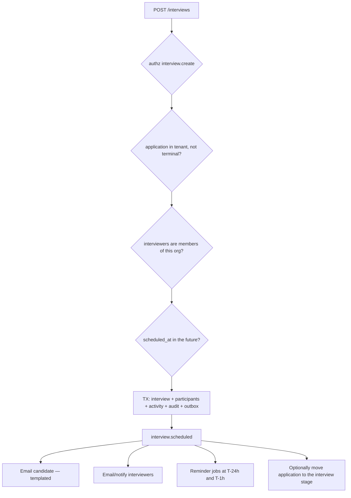

Reminders are scheduled as delayed jobs keyed by interview id, and cancelled on reschedule or
cancellation — otherwise a cancelled interview still reminds the candidate, which is worse than
no reminder at all.

Rescheduling writes a new `scheduled_at`, records `rescheduled_from`, re-emits notifications,
and re-schedules reminders. Cancellation requires a reason and notifies everyone.

---

## 8. Interview feedback

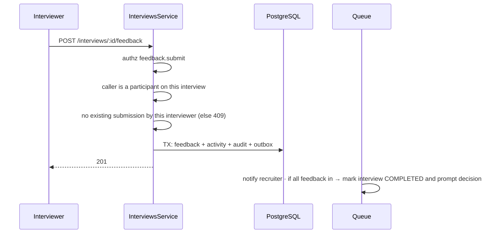

Feedback is immutable once `submitted_at` is set; corrections create a revision while the
interview is open. A hiring decision must be reconstructable months later.

---

## 9. AI candidate search

```mermaid
sequenceDiagram
    participant U as User
    participant O as Orchestrator
    participant M as Model
    participant T as Tool Router
    participant S as CandidatesService

    U->>O: "Python developers, 3+ years, currently interviewing"
    O->>O: build context; tool list filtered by this user's permissions
    O->>M: stream(system, messages, tools)
    M-->>T: search_candidates({ skills:["python"], minExperience:3, stageType:"INTERVIEW" })
    T->>T: validate input schema
    T->>T: assert candidate.read
    T->>S: search(ctx, filter)   ← same service the HTTP API uses
    S-->>T: page of candidates (tenant-scoped)
    T->>T: validate output, redact, cap rows
    T-->>M: tool_result
    M-->>U: streamed answer with candidate references
    O->>O: persist ai_message + ai_tool_execution (+ audit)
```

The model never sees SQL and never receives a database handle. It sees a typed tool whose
implementation is the same code path as `GET /candidates`.

---

## 10. AI candidate recommendation

Ranking a candidate against a job combines a **deterministic score** — skill overlap, years of
experience against the range, location and employment-type fit, salary alignment — computed in
a service, with an optional LLM-written rationale.

The score is deterministic and auditable and does not require AI. The narrative is the
enhancement. When AI is unavailable, recruiters still get ranked matches with the contributing
factors shown. Recommendations are advisory, never automatic actions: nothing moves stage or
rejects anyone on the strength of a score.

---

## 11. AI chat query

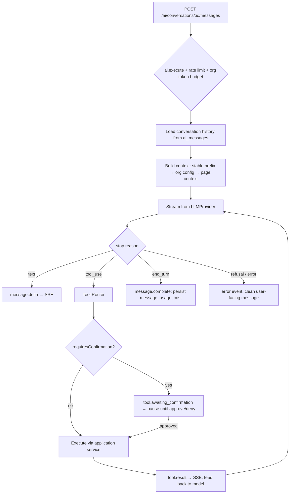

Turn count and tool calls per turn are capped. Token usage and cost in integer micros are
recorded per message for per-organization budgets.

---

## 12. RAG query _(reserved)_

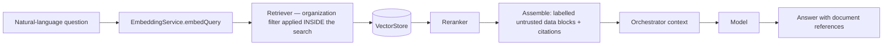

Retrieved text is candidate-authored and treated as data, never instruction. Retrieval grants
no capability the user does not already have. See
[rag-architecture.md](./rag-architecture.md).

---

## 13. MCP tool call _(reserved)_

```mermaid
sequenceDiagram
    participant X as External AI client
    participant M as MCP Server
    participant R as Tool Registry
    participant S as Application Service

    X->>M: tools/list
    M->>M: resolve principal + organization; assert mcp.execute
    M->>R: tools filtered by this principal's permissions
    R-->>X: descriptors (read-only unless org opted in)
    X->>M: tools/call get_job_pipeline { jobId }
    M->>R: validate input → permission check
    R->>S: same service the HTTP API and in-app AI use
    S-->>M: result (tenant-scoped)
    M->>M: audit (actor_type = MCP, client identity)
    M-->>X: tool result
```

---

## 14. Email sending

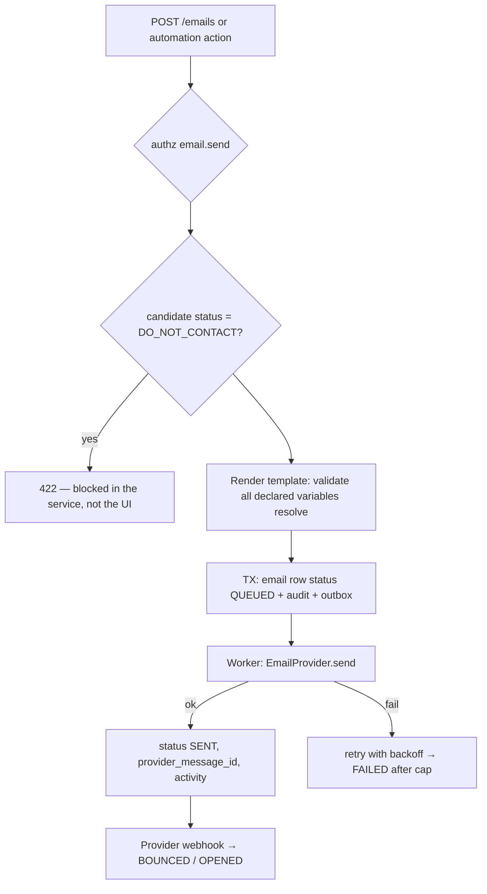

Consent enforcement lives in the service, so email triggered by an automation or an AI tool is
subject to the same check as a manual send. `Idempotency-Key` prevents a double-submit from
emailing a candidate twice.

---

## 15. Notification generation

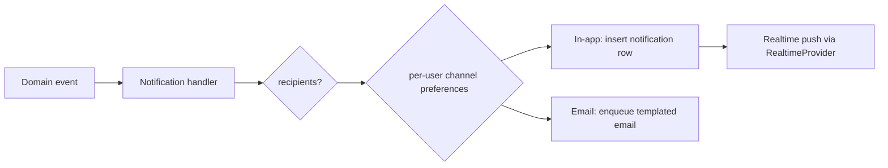

Recipients are computed from the event's entity — the application's owner, the job's hiring
manager, the interview's participants — never broadcast to the organization. Digest-mode
preferences batch low-urgency notifications instead of sending each one.

---

## 16. Automation execution

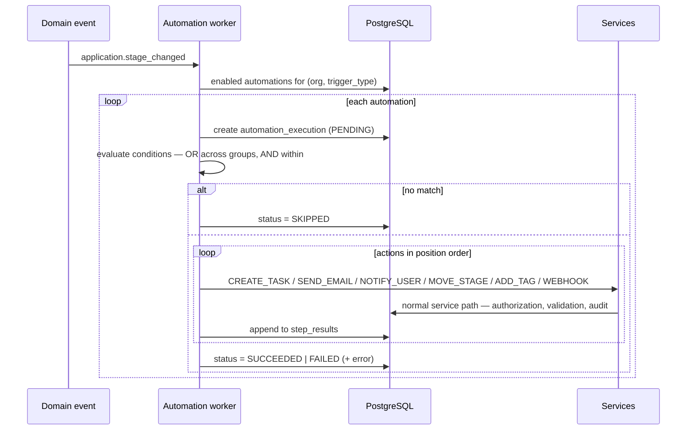

Three properties worth stating explicitly:

- Actions run through **application services**, so an automation cannot do anything a user
  could not, and every effect is audited with `actor_type = 'AUTOMATION'`.
- Loop protection: automation-originated events carry a depth marker, and a
  `MOVE_STAGE` action cannot re-trigger the same automation within one chain.
- Per-step results make a partially-failed automation debuggable, and
  `POST /automations/:id/test` performs a dry run that evaluates conditions and reports the
  actions it _would_ take without executing any of them.
