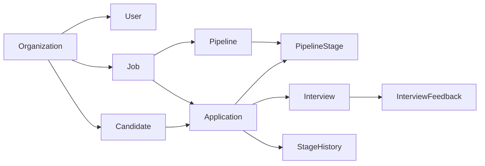
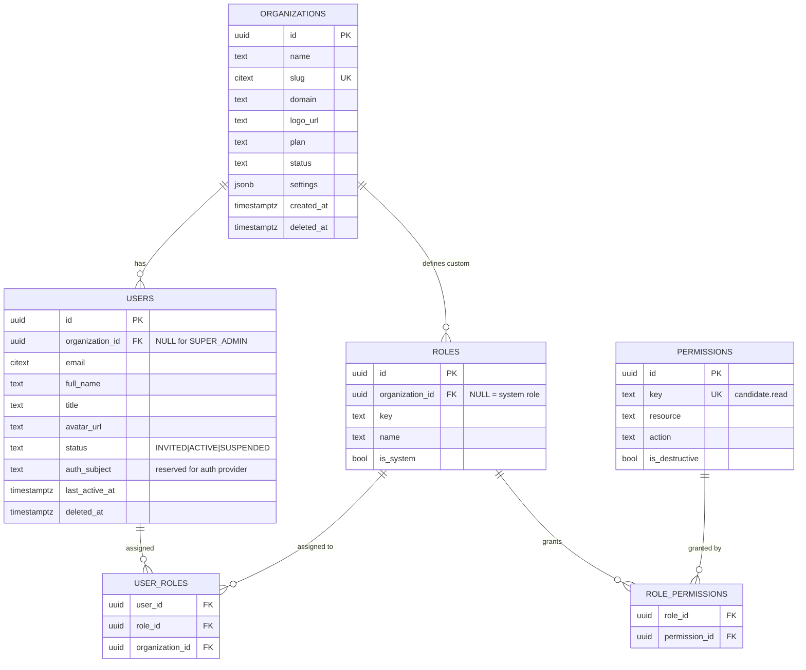
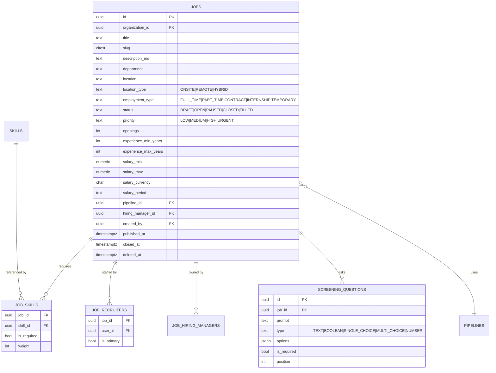
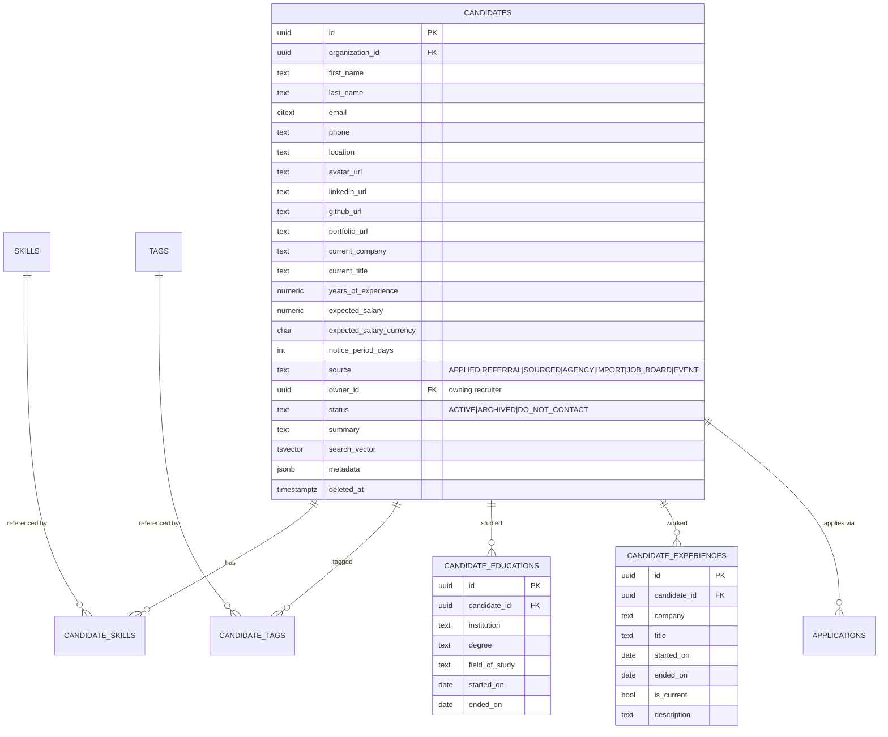
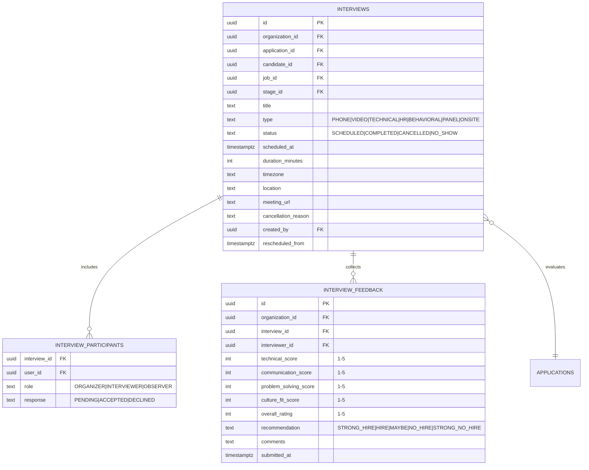
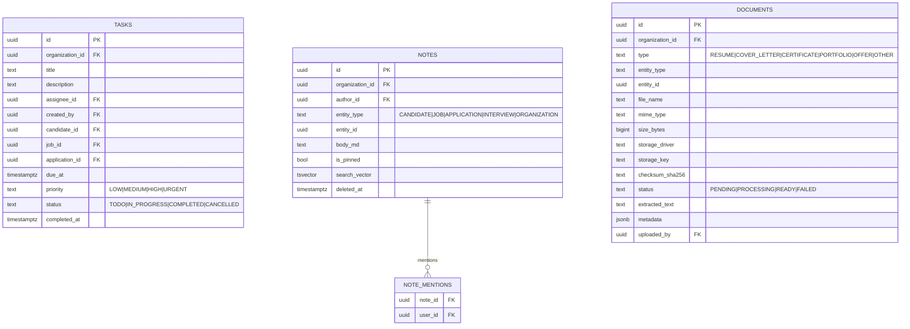
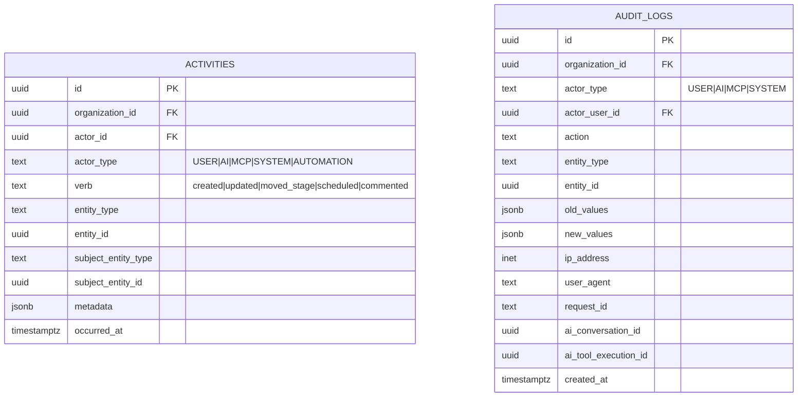
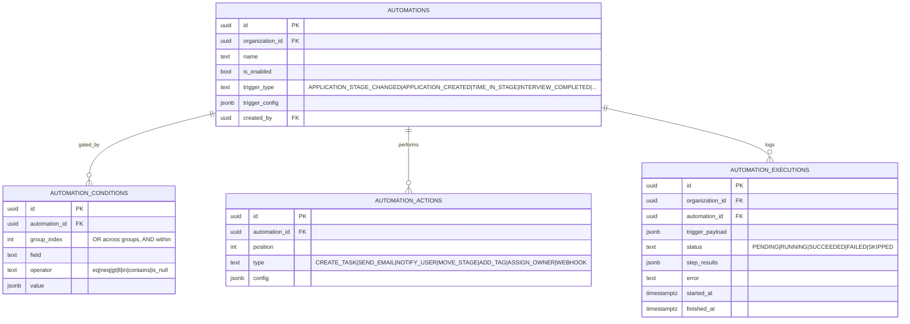
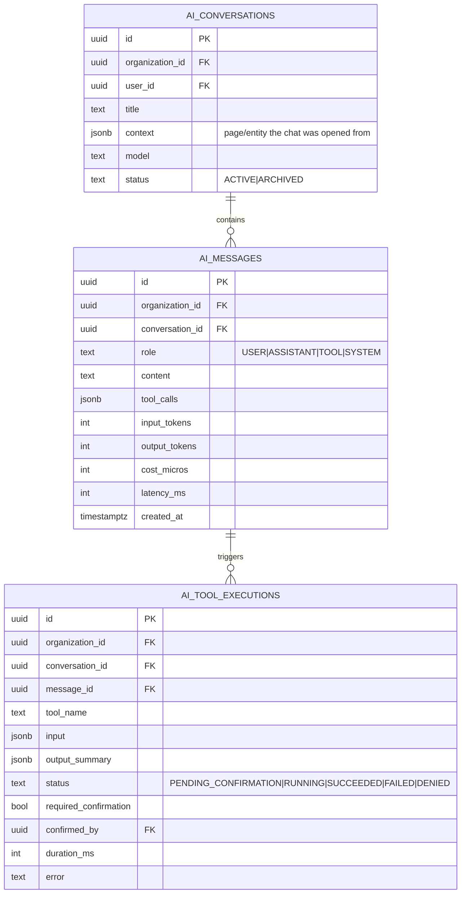

# RecruitFlow — Database Design

PostgreSQL 16, accessed through Prisma. This document is the authority on the data model;
`packages/database/prisma/schema.prisma` implements it.

## 1. Conventions

These apply to **every** table unless explicitly noted.

| Convention          | Rule                                                                                                                                                       |
| ------------------- | ---------------------------------------------------------------------------------------------------------------------------------------------------------- |
| Primary key         | `id uuid` — UUIDv7 generated in the application, so keys are time-sortable and index-local.                                                                |
| Tenancy             | `organization_id uuid NOT NULL` on every tenant-scoped table. No exceptions, even where it is derivable via a join — see §2.                               |
| Timestamps          | `created_at timestamptz NOT NULL DEFAULT now()`, `updated_at timestamptz NOT NULL`.                                                                        |
| Soft delete         | `deleted_at timestamptz NULL` on user-visible business entities only. Join tables, history, events, and audit rows are hard-deleted or never deleted.      |
| Naming              | `snake_case` tables (plural) and columns; Prisma models are `PascalCase` singular with `@@map`.                                                            |
| Enums               | Postgres native enums for closed sets that change with code; lookup tables for sets tenants configure (pipeline stages, rejection reasons, tags, sources). |
| Money               | `numeric(12,2)` + explicit `currency char(3)`. Never floats.                                                                                               |
| Free-form extension | `metadata jsonb NOT NULL DEFAULT '{}'` where tenants need custom fields; never a substitute for a real column.                                             |

### Why `organization_id` is denormalised everywhere

`interview_feedback` could reach its organization through
`interview → application → job → organization`. It stores `organization_id` anyway, because:

1. **RLS needs a local column.** A row-level security policy that has to join to establish
   tenancy is both slow and easy to get wrong.
2. **Every index becomes tenant-leading.** `(organization_id, …)` composite indexes keep a
   tenant's working set physically clustered — the difference between a 12ms and a 900ms
   query at a million rows.
3. **It makes leaks structurally visible.** A repository method without an
   `organization_id` predicate is greppable and lintable.

The cost is a consistency risk (a child pointing at a parent in another org). That is closed
by composite foreign keys — `FOREIGN KEY (organization_id, application_id) REFERENCES applications (organization_id, id)` —
so the database itself refuses to link rows across tenants.

## 2. Entity overview



## 3. Platform & identity



`permissions` is a **global catalog** — the only non-tenant table in the business schema.
Permission keys are code constants (`packages/core/permissions.ts`); the table exists so roles
can reference them and so the admin UI can render them. Organizations may define custom roles;
they may not invent permissions.

`users.auth_subject` is the seam for the reserved authentication module: whatever identity
provider is eventually used writes its subject claim here. Nothing else in the schema knows
how authentication works.

## 4. Jobs



Status is a state machine, enforced in `JobsService`, not by the database:

```
DRAFT ──publish──▶ OPEN ⇄ PAUSED
                    │        │
                    ├────────┴──close──▶ CLOSED
                    └──fill──▶ FILLED
```

## 5. Candidates



Note what is **not** here: no `stage`, no `application_status`, no `score`, no `job_id`. Those
belong to an application. A candidate's "status" is only about the relationship with the
organization (active, archived, do-not-contact for GDPR-style requests).

`skills` and `tags` are per-organization lookup tables with `unique (organization_id, slug)`.
Free-text skills on candidates would make "find Python developers" a substring search; a
normalised skill id makes it an index scan.

## 6. Pipelines & applications

```mermaid
erDiagram
    PIPELINES ||--o{ PIPELINE_STAGES : contains
    PIPELINE_STAGES ||--o{ APPLICATIONS : "current stage of"
    APPLICATIONS ||--o{ APPLICATION_STAGE_HISTORY : records
    APPLICATIONS ||--o{ INTERVIEWS : schedules
    APPLICATIONS }o--|| CANDIDATES : for
    APPLICATIONS }o--|| JOBS : to
    REJECTION_REASONS ||--o{ APPLICATIONS : explains

    PIPELINES {
        uuid id PK
        uuid organization_id FK
        text name
        bool is_default
        bool is_archived
    }
    PIPELINE_STAGES {
        uuid id PK
        uuid organization_id FK
        uuid pipeline_id FK
        text name
        text key
        text type "OPEN|OFFER|HIRED|REJECTED|ON_HOLD|WITHDRAWN"
        int position
        int sla_days
        bool is_terminal
    }
    APPLICATIONS {
        uuid id PK
        uuid organization_id FK
        uuid candidate_id FK
        uuid job_id FK
        uuid pipeline_id FK
        uuid stage_id FK
        text status "ACTIVE|HIRED|REJECTED|WITHDRAWN|ON_HOLD"
        text source
        uuid owner_id FK
        int score "0-100, nullable"
        jsonb screening_answers
        text cover_letter
        timestamptz applied_at
        timestamptz stage_entered_at
        timestamptz closed_at
        uuid rejection_reason_id FK
        text rejection_note
        timestamptz deleted_at
    }
    APPLICATION_STAGE_HISTORY {
        uuid id PK
        uuid organization_id FK
        uuid application_id FK
        uuid from_stage_id FK
        uuid to_stage_id FK
        uuid moved_by FK
        text actor_type "USER|AI|MCP|SYSTEM|AUTOMATION"
        int seconds_in_from_stage
        text note
        timestamptz moved_at
    }
```

**`unique (organization_id, candidate_id, job_id) WHERE deleted_at IS NULL`** — one person
applies to one job at most once. A re-application after rejection reopens the same row and
appends to history, preserving the audit trail.

`application_stage_history` is not a convenience log; it is the **source of truth for
analytics**. Time-in-stage, funnel conversion, and time-to-hire are all derived from it, which
is why `seconds_in_from_stage` is materialised at write time rather than computed by
self-joining a large table at read time.

`stage_entered_at` on `applications` duplicates the latest history row deliberately: SLA
queries ("applications sitting in Screening > 3 days") then hit one indexed column on the hot
table instead of aggregating history.

## 7. Interviews



`unique (interview_id, interviewer_id)` — one interviewer, one feedback record. Feedback is
immutable after `submitted_at`; corrections create a new revision rather than overwriting, so
a hiring decision can always be reconstructed. `candidate_id` and `job_id` are denormalised
onto `interviews` so the interviewer's "my interviews" query needs no joins.

## 8. Collaboration



Notes and documents attach **polymorphically** (`entity_type` + `entity_id`) rather than
having five nullable FK columns. The trade-off is losing database-level referential integrity
on the target; it is accepted because the alternative — a nullable FK per attachable type —
requires a migration every time a new entity becomes annotatable, and the note/document
services already validate the target exists within the tenant before writing.

`documents.storage_key` and `storage_driver` are stored together so a migration between
storage providers can proceed file by file without a flag day.

## 9. Communication & notifications

| Table             | Key columns                                                                                                                                                 | Notes                                                                                                                                                |
| ----------------- | ----------------------------------------------------------------------------------------------------------------------------------------------------------- | ---------------------------------------------------------------------------------------------------------------------------------------------------- |
| `email_templates` | `name`, `subject`, `body_md`, `category`, `variables jsonb`                                                                                                 | Variables are declared (`{{candidate_name}}`, `{{job_title}}`, `{{interview_date}}`, `{{recruiter_name}}`) so the composer can validate before send. |
| `emails`          | `direction`, `to_addresses text[]`, `subject`, `body`, `template_id`, `candidate_id`, `application_id`, `status`, `provider_message_id`, `sent_at`, `error` | `status`: `QUEUED\|SENDING\|SENT\|FAILED\|BOUNCED`. `provider_message_id` enables webhook reconciliation.                                            |
| `notifications`   | `user_id`, `type`, `title`, `body`, `entity_type`, `entity_id`, `channel`, `read_at`                                                                        | Index `(organization_id, user_id, read_at, created_at desc)` serves the unread badge and the feed from one index.                                    |

## 10. Activity & audit

Two tables, two purposes — a distinction worth being strict about.

|            | `activities`                              | `audit_logs`                                            |
| ---------- | ----------------------------------------- | ------------------------------------------------------- |
| Audience   | Recruiters, in the UI                     | Security, compliance, incident response                 |
| Content    | "Priya moved Alex to Technical Interview" | Full before/after values, IP, user agent, request id    |
| Scope      | Recruitment-meaningful events             | Every mutation, including config and permission changes |
| Mutability | Soft-deletable with the parent entity     | Append-only, never deleted, never edited                |
| Retention  | Tenant-configurable                       | Fixed, long                                             |



`ai_conversation_id` / `ai_tool_execution_id` on `audit_logs` are what make an AI-initiated
change traceable back to the exact prompt and tool call that caused it.

## 11. Automation



Conditions use `group_index` to express OR-of-ANDs without a nested tree, which keeps both the
evaluator and the builder UI simple. Actions execute in `position` order; each step's outcome
lands in `step_results` so a partially-failed automation is debuggable.

## 12. AI



Costs are stored in **integer micros**, not floats, so per-organization spend aggregates
exactly. `output_summary` stores a truncated/redacted result — never the full candidate
payload — so the AI log itself does not become a second, less-protected copy of the CRM.

## 13. Integrations & infrastructure tables

| Table                | Purpose                                                                                                                                                 |
| -------------------- | ------------------------------------------------------------------------------------------------------------------------------------------------------- |
| `integrations`       | Per-org external connections. Credentials in `config_encrypted bytea`, never plaintext jsonb.                                                           |
| `webhooks`           | Outbound: `url`, `events text[]`, `secret`, `is_active`.                                                                                                |
| `webhook_deliveries` | Delivery attempts with response code and retry count.                                                                                                   |
| `outbox_events`      | Transactional outbox: `event_name`, `payload`, `occurred_at`, `processed_at`, `attempts`, `error`. Written in the same transaction as the state change. |
| `saved_views`        | Per-user saved filters for candidates/jobs/applications lists.                                                                                          |

### Reserved (not created in the base build)

RAG tables — `document_chunks`, `embeddings` — are intentionally absent. The vector store is
behind an interface and may not be Postgres at all; creating pgvector tables now would encode
a decision that belongs to the RAG implementation. See
[rag-architecture.md](./rag-architecture.md).

## 14. Indexes

Indexes are added deliberately, each justified by a real query.

**Tenant-leading composites** (the default shape):

```sql
CREATE INDEX ON candidates    (organization_id, created_at DESC) WHERE deleted_at IS NULL;
CREATE INDEX ON candidates    (organization_id, owner_id, created_at DESC);
CREATE UNIQUE INDEX ON candidates (organization_id, email) WHERE deleted_at IS NULL;

CREATE INDEX ON jobs          (organization_id, status, created_at DESC) WHERE deleted_at IS NULL;
CREATE UNIQUE INDEX ON jobs   (organization_id, slug) WHERE deleted_at IS NULL;

CREATE INDEX ON applications  (organization_id, job_id, stage_id);          -- Kanban board
CREATE INDEX ON applications  (organization_id, candidate_id);              -- candidate timeline
CREATE INDEX ON applications  (organization_id, status, applied_at DESC);   -- list + funnel
CREATE INDEX ON applications  (organization_id, stage_entered_at)
    WHERE status = 'ACTIVE';                                                -- SLA / stale detection
CREATE UNIQUE INDEX ON applications (organization_id, candidate_id, job_id)
    WHERE deleted_at IS NULL;

CREATE INDEX ON application_stage_history (organization_id, application_id, moved_at);
CREATE INDEX ON application_stage_history (organization_id, to_stage_id, moved_at);  -- funnel

CREATE INDEX ON interviews    (organization_id, scheduled_at)  WHERE status = 'SCHEDULED';
CREATE INDEX ON interviews    (organization_id, application_id);
CREATE INDEX ON interview_participants (user_id, interview_id);              -- "my interviews"

CREATE INDEX ON tasks         (organization_id, assignee_id, status, due_at);
CREATE INDEX ON notes         (organization_id, entity_type, entity_id, created_at DESC);
CREATE INDEX ON documents     (organization_id, entity_type, entity_id);
CREATE INDEX ON activities    (organization_id, entity_type, entity_id, occurred_at DESC);
CREATE INDEX ON audit_logs    (organization_id, created_at DESC);
CREATE INDEX ON audit_logs    (organization_id, entity_type, entity_id, created_at DESC);
CREATE INDEX ON notifications (organization_id, user_id, read_at, created_at DESC);
CREATE INDEX ON outbox_events (processed_at, occurred_at) WHERE processed_at IS NULL;
```

**Search**:

```sql
CREATE INDEX ON candidates USING gin (search_vector);
CREATE INDEX ON notes      USING gin (search_vector);
CREATE INDEX ON candidates USING gin (
    (first_name || ' ' || last_name || ' ' || email) gin_trgm_ops
);  -- typo-tolerant quick-find in the command palette
```

`search_vector` is maintained by a trigger over name, email, current company/title, and
summary — not by application code, so an import path that bypasses the service layer cannot
leave the index stale.

**Skill filtering** — `candidate_skills (organization_id, skill_id, candidate_id)` makes
"Python developers with 3+ years" an index-only scan intersected with a range predicate on
`candidates.years_of_experience`.

## 15. Constraints

- Composite FKs `(organization_id, <parent_id>)` on every child of a tenant-scoped parent —
  the cross-tenant-link guard described in §1.
- `CHECK (salary_min <= salary_max)`, `CHECK (experience_min_years <= experience_max_years)`.
- `CHECK (score BETWEEN 0 AND 100)`; feedback scores `CHECK (x BETWEEN 1 AND 5)`.
- `CHECK (status <> 'REJECTED' OR rejection_reason_id IS NOT NULL)` — a rejection always has
  a reason, which is what makes rejection analytics trustworthy.
- `ON DELETE RESTRICT` for entities that carry history (candidates, jobs, applications);
  `ON DELETE CASCADE` only for owned children (job_skills, interview_participants, note_mentions).

## 16. Row-Level Security

RLS is enabled on every tenant-scoped table as an independent second layer:

```sql
ALTER TABLE candidates ENABLE ROW LEVEL SECURITY;
ALTER TABLE candidates FORCE ROW LEVEL SECURITY;

CREATE POLICY tenant_isolation ON candidates
  USING (organization_id = current_setting('app.current_organization_id', true)::uuid);
```

The application sets `app.current_organization_id` per transaction from `TenantContext`. The
application's database role is **not** the table owner and does **not** have `BYPASSRLS`;
migrations run as a separate privileged role. A bug in a repository therefore produces zero
rows, not another tenant's rows.

## 17. Migrations & seeding

- Prisma Migrate, forward-only. Every migration reviewed for lock behaviour; index creation
  uses `CONCURRENTLY` in production.
- Expand → migrate → contract for column changes; no destructive migration ships in the same
  release as the code that stops using the column.
- Seed data (`packages/database/prisma/seed.ts`): permission catalog, system roles, a demo
  organization, the default pipeline, standard rejection reasons, and email templates. Demo
  candidates/jobs/applications are generated behind a flag for load testing.
