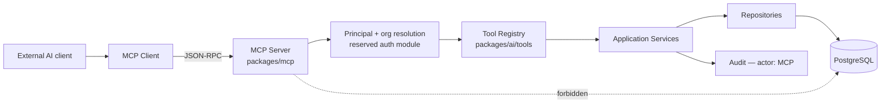
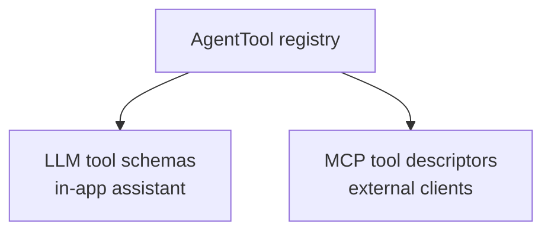

# RecruitFlow — MCP Architecture _(extension point — not implemented)_

**Status: reserved.** The base build defines the package layout and the contracts below. It
does not ship an MCP server. This document exists so the eventual implementation is a
_binding_, not a redesign.

## 1. What MCP buys RecruitFlow

The Model Context Protocol lets an external AI client — a desktop assistant, an IDE, another
agent — call RecruitFlow's capabilities directly. A recruiter can ask their own assistant to
"check who's in final-round interviews this week" without opening RecruitFlow.

The architectural point is what MCP must **not** be: a second API with its own logic. It is a
transport over the tool registry that already exists.



## 2. One registry, two transports



The MCP server derives its tool list from the same `AgentTool[]`:

```ts
// packages/mcp/tools/adapter.ts  (shape)
export function toMcpTool(tool: AgentTool<unknown, unknown>): McpToolDescriptor {
  return {
    name: tool.name,
    description: tool.description,
    inputSchema: zodToJsonSchema(tool.inputSchema),
    annotations: {
      readOnlyHint: tool.sideEffects === 'none',
      destructiveHint: tool.requiresConfirmation,
    },
  };
}
```

A new capability added for the in-app assistant becomes available over MCP with no extra work
and — critically — with the same permission requirements. Duplicating business logic into
`packages/mcp` is the failure mode this design exists to prevent; it would mean two
authorization implementations that drift.

## 3. Package layout

```text
packages/mcp/
├── server/          # transport (stdio + streamable HTTP), JSON-RPC, session lifecycle
├── tools/           # AgentTool → MCP descriptor adapter; MCP-specific wrappers
├── resources/       # read-only resource exposure (see §5)
├── schemas/         # JSON Schema generation and validation
└── auth/            # principal resolution — depends on the reserved auth module
```

## 4. Authorization

MCP is the highest-risk surface in the system: an external client, outside the browser session,
requesting arbitrary tool calls. Three requirements:

1. **Every connection resolves to a real principal in a real organization.** There is no
   service-account mode that can read across tenants, and no anonymous access.
2. **`mcp.execute` is a distinct permission**, granted separately from `ai.execute`. An
   organization can enable the in-app assistant while forbidding external MCP entirely.
3. **The tool list is filtered per principal**, exactly as in the in-app assistant. `tools/list`
   returns only what this principal may call.

Beyond that: rate limits per connection, an org-level kill switch (`MCP_ENABLED`), scoped and
revocable credentials, and audit rows with `actor_type = 'MCP'` carrying the client identity.

Confirmation-required tools present a real problem over MCP — there is no RecruitFlow UI to
approve in. The default posture is therefore **read-only over MCP**: tools with
`sideEffects !== 'none'` are excluded unless the organization explicitly opts in, and even then
destructive tools route through an approval that the recruiter resolves inside RecruitFlow
(notification → approve → the pending call executes). Silently allowing an external client to
email candidates would be indefensible.

## 5. Resources

MCP resources expose read-only context an external model can pull:

| URI pattern                       | Content                          |
| --------------------------------- | -------------------------------- |
| `recruitflow://candidate/{id}`    | Candidate profile summary        |
| `recruitflow://job/{id}`          | Job description and requirements |
| `recruitflow://job/{id}/pipeline` | Stage counts for the job         |
| `recruitflow://application/{id}`  | Application status and history   |

Resource reads go through the same services and the same authorization as tools. Access is
audited: a resource read is a data access, and "it was only a read" is not a reason to omit it
from the audit trail.

## 6. Transports

- **stdio** — local clients (desktop assistant, IDE), process-scoped, credentials from the
  environment.
- **Streamable HTTP** — remote clients, authenticated per request, rate-limited, terminating at
  `apps/api`.

Both are thin adapters over the same server core.

## 7. What is deliberately not decided here

The SDK version, the exact session and capability negotiation, the credential format, and the
approval UX. Those belong to the implementation. The commitments this document does make:
MCP reuses `packages/ai/tools`, MCP never reaches a repository, and MCP actions are auditable
with the same fidelity as human ones.
