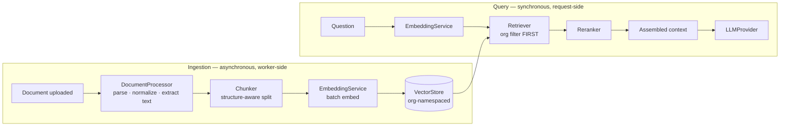

# RecruitFlow — RAG Architecture _(extension point — not implemented)_

**Status: reserved.** The base build ships the interfaces below and nothing else. No embedding
provider, no vector store, no chunker, no retrieval pipeline. This document defines the
contract the eventual implementation must satisfy so that it drops in without touching the
rest of the system.

Deliberately absent: any dependency on pgvector, Qdrant, Pinecone, Chroma, or a specific
embedding model. Choosing one now would be a decision made at the point of least information.

## 1. Why RAG here

Recruitment data is mostly _documents_: resumes, cover letters, portfolios, interview notes,
job descriptions. Structured search answers "Python, 3+ years, in Interview stage". It cannot
answer "who has led a migration off a monolith?" — that sentence lives in prose inside a PDF.

RAG is an enhancement over structured search, never a replacement. If retrieval is unavailable,
`search_candidates` still works on skills, tags, and stage.

## 2. Pipeline



Ingestion is triggered by the `document.uploaded` domain event and runs entirely in the worker.
A document upload never waits on embedding — the document is `READY` for download the moment it
is stored, and separately becomes searchable when indexing completes.

## 3. Interfaces

```ts
// packages/ai/rag/*  — shapes, not implementations

export interface ProcessedDocument {
  documentId: string;
  organizationId: string;
  mimeType: string;
  text: string;
  pages?: { page: number; text: string }[];
  metadata: Record<string, unknown>; // parser confidence, language, page count
}

export interface DocumentProcessor {
  supports(mimeType: string): boolean;
  process(input: {
    buffer: Buffer;
    mimeType: string;
    fileName: string;
  }): Promise<ProcessedDocument>;
}

export interface Chunk {
  id: string;
  text: string;
  ordinal: number;
  metadata: ChunkMetadata;
}

export interface ChunkMetadata {
  organizationId: string; // MANDATORY on every chunk
  documentId: string;
  entityType: 'CANDIDATE' | 'JOB' | 'APPLICATION' | 'INTERVIEW' | 'NOTE';
  entityId: string;
  documentType: string;
  section?: string; // 'experience' | 'education' | …
  page?: number;
  createdAt: string;
}

export interface Chunker {
  chunk(doc: ProcessedDocument): Promise<Chunk[]>;
}

export interface EmbeddingService {
  readonly model: string;
  readonly dimensions: number;
  embed(texts: string[]): Promise<number[][]>; // batched
  embedQuery(text: string): Promise<number[]>; // may use a different prefix/instruction
}

export interface VectorStore {
  upsert(ctx: TenantContext, records: VectorRecord[]): Promise<void>;
  query(ctx: TenantContext, q: VectorQuery): Promise<ScoredChunk[]>;
  deleteByDocument(ctx: TenantContext, documentId: string): Promise<void>;
  deleteByOrganization(organizationId: string): Promise<void>; // GDPR erasure
}

export interface VectorQuery {
  embedding: number[];
  topK: number;
  filter?: {
    // organizationId is injected by the store, not the caller
    entityType?: ChunkMetadata['entityType'];
    entityIds?: string[];
    documentType?: string[];
    createdAfter?: string;
  };
  minScore?: number;
}

export interface Retriever {
  retrieve(ctx: TenantContext, query: string, opts?: RetrieveOptions): Promise<ScoredChunk[]>;
}

export interface Reranker {
  rerank(query: string, chunks: ScoredChunk[], topN: number): Promise<ScoredChunk[]>;
}

export interface RAGService {
  index(ctx: TenantContext, documentId: string): Promise<void>;
  remove(ctx: TenantContext, documentId: string): Promise<void>;
  answerContext(
    ctx: TenantContext,
    query: string,
    opts?: RetrieveOptions,
  ): Promise<RetrievedContext>;
  health(): Promise<{ ok: boolean; detail?: string }>;
}
```

## 4. Tenant isolation — the non-negotiable part

A vector store is the easiest place in a multi-tenant system to leak data, because similarity
search does not naturally respect boundaries and a post-filter feels like it works.

**Rules the implementation must follow:**

1. `organizationId` is on **every** chunk's metadata. A chunk without one is rejected at
   `upsert`, not silently indexed.
2. The organization filter is applied **inside** the search, not after it. Retrieving top-50
   globally and then discarding other tenants' rows is wrong twice: it leaks through timing and
   scoring, and it silently returns fewer than 50 usable results.
3. `VectorStore` methods take `TenantContext` and inject the filter themselves. Callers cannot
   opt out — there is no `query(embedding)` overload.
4. Prefer **physical** separation where the store supports it cheaply: a namespace, collection,
   or partition per organization. Logical filtering is the fallback, not the default.
5. Deletion is a first-class operation. `deleteByOrganization` must fully remove vectors — an
   erasure request that leaves embeddings behind is a compliance failure, and embeddings are
   partially invertible.
6. Isolation is verified by an automated test that indexes into two organizations and asserts
   zero cross-tenant hits for a query engineered to match the other tenant's content.

## 5. Chunking guidance

Resumes are structured documents; naive fixed-size splitting cuts a job entry in half and
produces chunks that answer nothing. The chunker should be section-aware — experience,
education, skills, projects — with overlap only within a section, and should carry the
candidate's name and current role into each chunk's context so a retrieved fragment is
attributable without a second lookup.

## 6. Hybrid retrieval

Semantic search alone is bad at exact terms — a search for "Kubernetes" should not rank
"container orchestration experience" above a resume that literally says Kubernetes. The
intended end state combines Postgres full-text/trigram search with vector search and fuses the
rankings, which is why `SearchProvider` and `Retriever` are separate interfaces that a hybrid
driver can implement together.

## 7. Cost and freshness

- Embedding runs in the worker, batched, with retry and a dead-letter queue.
- Re-embedding is triggered by a content checksum change, not by any update to the row.
- Model or dimension changes require a versioned index and a backfill; `VectorRecord` carries
  the embedding model id so two versions can coexist during migration.
- Indexing is idempotent per `(documentId, chunkOrdinal, embeddingModel)`.

## 8. Integration point

When implemented, `RAGService` is injected into the AI context builder and, optionally, backs a
`semantic_search_candidates` tool. Both are additive:

```ts
// packages/ai/orchestrator/context-builder.ts
if (rag?.enabled) {
  const retrieved = await rag.answerContext(ctx, userQuery, { topK: 8 });
  contextBlocks.push(renderAsUntrustedData(retrieved)); // labelled, delimited, never as instruction
}
```

`renderAsUntrustedData` matters: retrieved chunks are candidate-authored text and are a prompt
injection vector. They are wrapped and labelled as data, and — the real control — retrieval
grants no capability the user does not already have. See
[ai-architecture.md §6](./ai-architecture.md#6-security).
