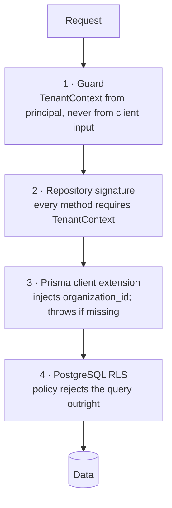

# RecruitFlow — Security

RecruitFlow holds candidates' names, contact details, salary expectations, employment history,
resumes, and interview feedback about them — for organizations that are competitors. Both
facts drive the security posture: personal data under GDPR-style regimes, and tenant isolation
as a business-critical property rather than a nice-to-have.

## 1. Threat model

| Actor                         | Capability                    | Primary risk                            |
| ----------------------------- | ----------------------------- | --------------------------------------- |
| Anonymous internet            | Public endpoints, uploads     | Injection, DoS, enumeration             |
| Authenticated user, own org   | Full API within permissions   | Privilege escalation, over-broad access |
| Authenticated user, other org | Full API within _their_ org   | **Cross-tenant read** — the top risk    |
| Candidate (future portal)     | Own records only              | Horizontal access to other candidates   |
| Compromised recruiter account | Everything that user could do | Bulk export, exfiltration               |
| Malicious content author      | Writes resume/note text       | **Prompt injection**, stored XSS        |
| External AI client (MCP)      | Tool calls                    | Automated exfiltration at machine speed |
| Insider / operator            | Database, logs                | Unaudited access, secret exposure       |

## 2. Tenant isolation — four independent layers

Isolation is the property most worth over-engineering, because a single missing `WHERE` clause
is a company-ending incident and an easy mistake.

1. **Guard.** The organization is derived from the authenticated principal. A client-supplied
   `X-Organization-Id` is honoured only for `SUPER_ADMIN`, and that path is separately audited.
2. **Repository signature.** `findMany(ctx, filter)` — there is no overload without a context,
   so omitting tenancy is a compile error rather than a runtime leak.
3. **Prisma extension.** Every query against a tenant-scoped model has `organization_id`
   injected; a query built without a context throws before reaching the database. This catches
   the case where someone adds a raw model access inside a service.
4. **Row-Level Security.** `app.current_organization_id` is set per transaction; policies
   compare against it. The application role is not the table owner and lacks `BYPASSRLS`, so a
   bug in layers 1–3 returns zero rows rather than someone else's.

Plus a database-level guard against _linking_ across tenants: composite foreign keys
`(organization_id, parent_id)` make a cross-tenant reference impossible to insert. See
[database.md §1](./database.md#1-conventions).

**Verification is mandatory.** Each module's integration suite seeds two organizations and
asserts that every read, list, update, and delete path returns `404`/`0 rows` across the
boundary. A new endpoint without a tenant-isolation test is not done.

**Cross-tenant reads return `404`, not `403`.** A 403 confirms the resource exists somewhere,
which is itself a disclosure.

## 3. Authentication _(reserved module)_

Not implemented in the base build. The seam is `AuthProvider` plus `users.auth_subject`; the
guard chain, `TenantContext`, and every permission check are already in place and provider-
agnostic. When the real implementation lands, these are its obligations:

- Short-lived access tokens, rotating refresh tokens, server-side revocation.
- Password hashing with a memory-hard algorithm; MFA; SSO/SAML for enterprise tenants.
- Session invalidation on role change, password change, and member removal.
- Login rate limiting per IP and per account, with lockout and alerting.
- The dev identity driver (`AUTH_DRIVER=dev`) must be impossible to enable outside
  `NODE_ENV=development` — enforced by a config assertion at boot, not by convention.

## 4. Authorization

Permission checks live at the **service** boundary. Controllers declare requirements; services
enforce them; the frontend only hides UI.

Two distinct questions, both answered server-side:

- **Permission** — may this principal do this _kind_ of thing? (`interview.read`)
- **Scope** — to _which rows_? An `INTERVIEWER` holds `interview.read` but the repository
  restricts to interviews where they are a participant.

Additional rules: object-level checks on every `:id` route (never trust that an id implies
access), field-level restrictions (only `ORG_ADMIN` may change member roles), and no
mass-assignment — request DTOs are explicit allowlists, so `{"role": "ORG_ADMIN"}` in a profile
update body is rejected as an unknown field rather than silently applied.

## 5. Input validation

Every request body, query string, and path parameter is parsed by a Zod schema at the API
boundary; unknown fields are rejected rather than stripped, so a typo fails loudly.

| Vector                 | Control                                                                                                                                                                                                                     |
| ---------------------- | --------------------------------------------------------------------------------------------------------------------------------------------------------------------------------------------------------------------------- |
| SQL injection          | Prisma parameterises everything. Raw SQL is confined to reviewed analytics queries using tagged templates; string-concatenated SQL is a lint error.                                                                         |
| NoSQL/filter injection | Filters map to an explicit allowlist of fields and operators; arbitrary operator objects are never passed through.                                                                                                          |
| XSS                    | React escapes by default. Note bodies are Markdown, rendered through a sanitiser with a strict allowlist — no raw HTML, no `javascript:` URLs. `dangerouslySetInnerHTML` is banned by lint.                                 |
| CSRF                   | The API is token-authenticated and does not accept cookie auth for mutations. Where the Next.js BFF holds a session cookie it is `SameSite=Lax`, `HttpOnly`, `Secure`, and mutating BFF routes carry a double-submit token. |
| SSRF                   | Any user-supplied URL (portfolio links, webhook targets, avatar imports) is validated against a scheme allowlist and a private-IP/link-local denylist, with redirects re-validated at each hop.                             |
| Path traversal         | Storage keys are generated server-side; the client never supplies a path.                                                                                                                                                   |
| ReDoS                  | No user-supplied regex; server-side patterns are bounded and linted.                                                                                                                                                        |
| Mass assignment        | Explicit DTOs; unknown keys rejected.                                                                                                                                                                                       |

## 6. File uploads

In order: size cap (20 MB) → extension allowlist → **magic-byte sniff that must match the
declared MIME type** → generated storage key (original filename stored as metadata only) →
stored outside any web root → SHA-256 recorded → optional AV scan hook before status becomes
`READY`.

The magic-byte check is the one that matters — an extension allowlist alone is defeated by
renaming. Downloads go only through `GET /documents/:id/download`, which authorizes and then
issues a short-lived signed URL; buckets are never public. Responses force
`Content-Disposition: attachment` and `X-Content-Type-Options: nosniff`, so an HTML file
uploaded as a "portfolio" cannot execute in the application's origin.

## 7. AI and MCP security

Detailed in [ai-architecture.md §6](./ai-architecture.md#6-security). The essentials:

- **The AI actor has no privileges of its own.** It carries the invoking user's permission set,
  so it can never exceed them.
- **Capability is controlled by tool availability, not by prompt text.** "Don't delete
  candidates" in a system prompt is a suggestion; omitting the tool is a control.
- **Prompt injection is contained by design.** Candidate-authored text (resumes, notes,
  emails) reaches the model as delimited, labelled untrusted data. Even a fully successful
  injection cannot exceed the user's permissions and cannot take an externally-visible action
  without human confirmation.
- **Externally-visible actions require confirmation** — email, calendar invites, stage changes
  that notify candidates.
- **Tool results are redacted and bounded**, so conversation storage does not become a
  lower-protection copy of the CRM.
- **MCP is read-only by default** and gated by a separate `mcp.execute` permission plus an
  org-level kill switch.

## 8. Secrets

Read once at boot through a Zod-validated config module; application code never touches
`process.env`. No secret in source, in the frontend bundle, or in logs. Integration credentials
are stored encrypted (`integrations.config_encrypted`), never as plaintext JSONB. Webhook
signing secrets are per-endpoint and rotatable. CI enforces secret scanning; a leaked key is
rotated, not merely removed from history.

## 9. Rate limiting and abuse

Per-principal and per-organization limits ([api.md §5](./api.md#5-rate-limiting)), with tighter
limits on auth, bulk, export, and AI endpoints. Bulk export is permission-gated, audited, and
alertable — mass export is the clearest signal of a compromised account. Application-level
limits complement, and do not replace, edge protection.

## 10. Logging and audit

- **Structured logs** with request id, organization id, user id — never bodies, tokens,
  passwords, or full candidate records. Prompts and completions are excluded.
- **Audit log** is append-only: actor (including `AI`/`MCP`), action, entity, before/after
  values, IP, user agent, request id, and AI conversation/tool-execution ids where applicable.
- Audit rows are written in the same transaction as the change they describe, so the trail
  cannot silently diverge from reality.
- Audit access is itself permission-gated (`audit.read`).

## 11. Privacy and data lifecycle

- **Erasure**: a candidate deletion request must remove the row, documents in object storage,
  extracted text, and any embeddings. Audit records are retained with the subject pseudonymised
  — legal-hold obligations and erasure obligations are reconciled explicitly, not by accident.
- **Export**: subject access requests produce a machine-readable bundle.
- **Consent and retention**: `candidates.status = 'DO_NOT_CONTACT'` is enforced in the email
  service, not just the UI. Retention windows are per-organization configuration.
- **Minimisation**: tool outputs, list endpoints, and logs return the least data that satisfies
  the use case.

## 12. Transport and headers

TLS everywhere with HSTS. Security headers set at the edge: a strict `Content-Security-Policy`
with no `unsafe-inline` for scripts, `X-Content-Type-Options: nosniff`,
`Referrer-Policy: strict-origin-when-cross-origin`, `X-Frame-Options: DENY`, and a restrictive
`Permissions-Policy`. CORS allowlists exact origins — never `*` with credentials.

## 13. Dependencies and CI

Lockfiles committed; automated vulnerability scanning on PRs; SAST and secret scanning in CI;
container images pinned by digest and rebuilt on base-image CVEs. Every dependency added to the
`apps/api` runtime is a review point, because it inherits database access.
