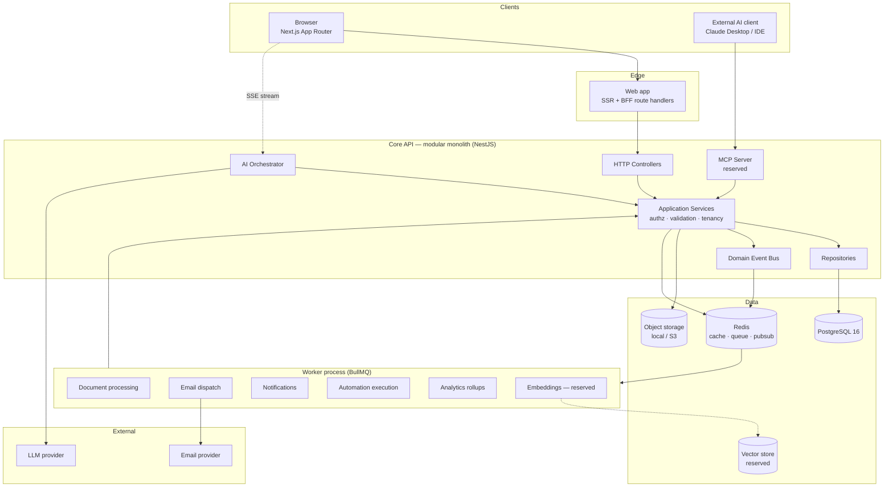
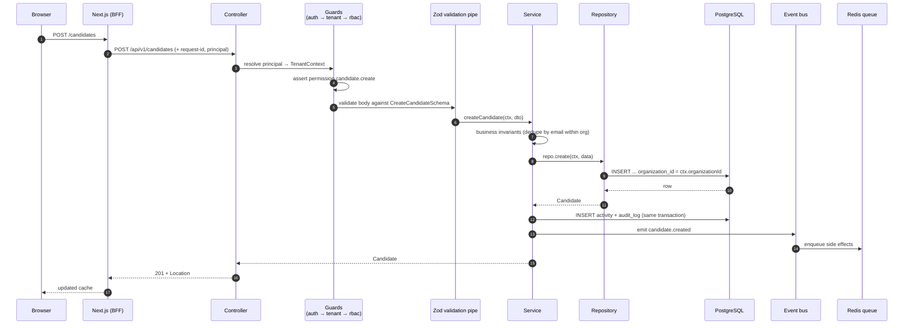
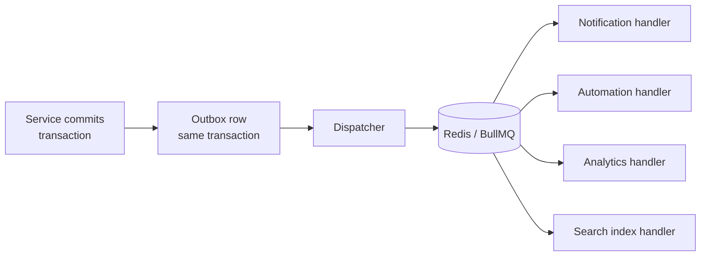
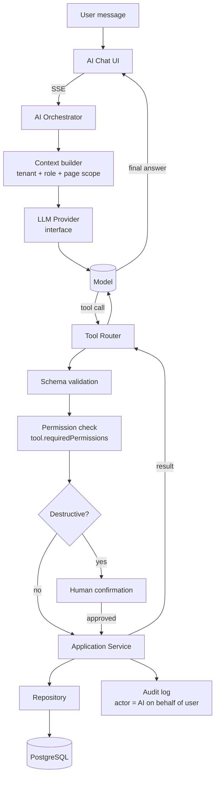
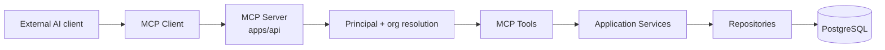
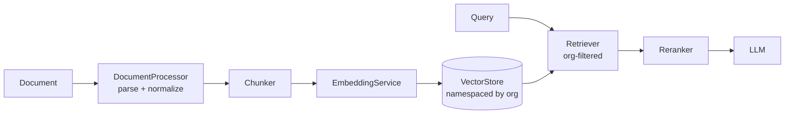

# RecruitFlow — System Design

This document describes the **runtime**: what processes exist, what they talk to, and how a
request travels. For how the _code_ is organised, see [architecture.md](./architecture.md).

## 1. High-level architecture

### Process topology

The base build runs **two Node processes** plus infrastructure:

| Process       | Responsibility                                         | Scaling axis                         |
| ------------- | ------------------------------------------------------ | ------------------------------------ |
| `apps/web`    | Next.js SSR, UI, thin BFF route handlers               | Stateless; scale on user concurrency |
| `apps/api`    | HTTP API, AI orchestrator, MCP server, domain services | Stateless; scale on request volume   |
| `apps/worker` | Queue consumers; imports the same service layer        | Scale on queue depth, independently  |

`api` and `worker` share the entire application/service/repository layer. A worker is not a
second implementation of the business logic — it is a different _entry point_ to the same
services. This is what makes the monolith safely splittable later.

## 2. Request flow — synchronous write

Three properties this flow guarantees:

1. **Authorization precedes validation precedes business logic.** A caller without permission
   never reaches a service method, and never learns whether the resource exists.
2. **Audit is transactional.** The audit row commits with the change or not at all — audit
   cannot silently drift from reality.
3. **Side effects are asynchronous.** Emails, notifications, automations, and analytics
   rollups happen off the request path. A dead SMTP server cannot fail a candidate creation.

## 3. Domain events

Services emit domain events after a successful commit. Events are the seam between modules —
the Candidates module never imports the Notifications module.

| Event                                                 | Emitted by   | Typical consumers                               |
| ----------------------------------------------------- | ------------ | ----------------------------------------------- |
| `candidate.created` / `.updated`                      | Candidates   | Search index, activity, automations             |
| `application.created`                                 | Applications | Notifications, automations, analytics           |
| `application.stage_changed`                           | Applications | Notifications, automations, analytics, activity |
| `application.rejected`                                | Applications | Notifications, analytics                        |
| `interview.scheduled` / `.rescheduled` / `.cancelled` | Interviews   | Notifications, email, calendar                  |
| `interview.feedback_submitted`                        | Interviews   | Notifications, analytics                        |
| `document.uploaded`                                   | Documents    | Document processing, embeddings _(reserved)_    |
| `task.assigned` / `.due_soon`                         | Tasks        | Notifications                                   |
| `ai.tool_executed`                                    | AI           | Audit, observability, cost accounting           |

Events are written to a **transactional outbox** in the same transaction as the state change,
then relayed to the queue. This avoids the classic failure where the row commits but the
event is lost (or vice versa) because the queue and the database are separate systems.

## 4. AI request flow

The orchestrator holds **no** database access of its own. Its only capabilities are the tools
registered in the tool registry, and every tool is a thin adapter over an application service.
Detailed in [ai-architecture.md](./ai-architecture.md).

## 5. MCP flow _(reserved — contracts only)_

MCP tools wrap the **same** `AgentTool` definitions the AI orchestrator uses. There is one
tool registry, exposed through two transports. See [mcp-architecture.md](./mcp-architecture.md).

## 6. RAG flow _(reserved — interfaces only)_

Every vector carries `organization_id` in its metadata, and every retrieval applies an
organization filter _before_ similarity search — not after. See
[rag-architecture.md](./rag-architecture.md).

## 7. Supporting subsystems

| Subsystem | Interface          | Base-build driver      | Future drivers                  |
| --------- | ------------------ | ---------------------- | ------------------------------- |
| Cache     | `CacheProvider`    | Redis                  | Multi-tier (in-process + Redis) |
| Queue     | `QueueProvider`    | BullMQ / Redis         | SQS, Temporal                   |
| Storage   | `StorageProvider`  | Local disk             | S3, Cloudinary, Supabase        |
| Search    | `SearchProvider`   | Postgres FTS + trigram | OpenSearch, vector, hybrid      |
| Email     | `EmailProvider`    | SMTP (Mailpit in dev)  | SES, Resend, Gmail, Outlook     |
| Realtime  | `RealtimeProvider` | SSE                    | WebSockets + Redis pub/sub      |
| LLM       | `LLMProvider`      | Anthropic (optional)   | Any; selected by config         |
| Auth      | `AuthProvider`     | Dev identity driver    | OAuth/JWT/SSO _(reserved)_      |

Every one of these is chosen by a single config value and bound once in a DI module. No
application service imports a driver directly — that is enforced by an import-boundary lint
rule described in [engineering-rules.md](./engineering-rules.md).

## 8. Failure behaviour

| Dependency down    | Effect                                                                                                                                  |
| ------------------ | --------------------------------------------------------------------------------------------------------------------------------------- |
| LLM provider       | AI chat returns a clear error; **all** CRM/ATS functions unaffected.                                                                    |
| Redis              | Queue and cache degrade; API falls back to direct reads; async side effects retry when Redis returns (outbox rows persist in Postgres). |
| Object storage     | Document upload/download fails; everything else unaffected.                                                                             |
| SMTP               | Email jobs retry with backoff; no user-facing write fails.                                                                              |
| Vector store / MCP | Reserved features disabled; no core impact.                                                                                             |
| **PostgreSQL**     | Hard dependency. This is the only single point of failure by design.                                                                    |
